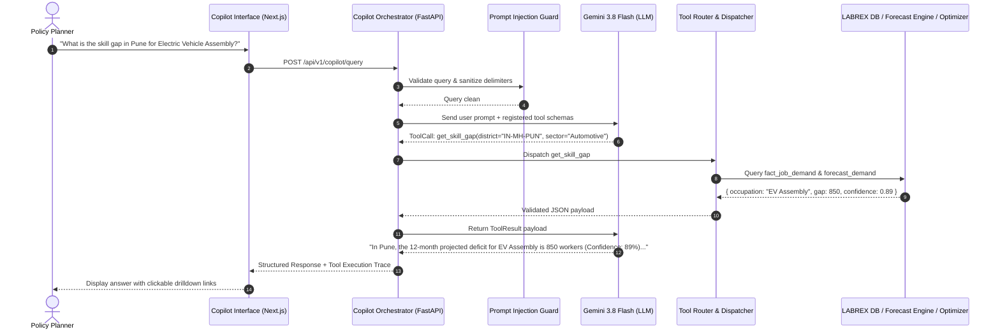

# LABREX AI Copilot & RAG Architecture

**Document Version:** 1.0  
**Authority:** Master Directive Section 34, 35, 36 & 37  
**Guiding Principle:** The AI is an explainer and router; numbers and recommendations come from verified tools.  

---

## 1. Copilot Topology & Execution Flow

---

## 2. Tool Registry & Strict Typed Signatures

All Copilot capabilities are exposed via Pydantic schemas. Gemini is provided only structured tool definitions:

| Tool Name | Parameters | Permitted Actions | Returned Entity |
| :--- | :--- | :--- | :--- |
| `get_national_snapshot` | `horizon: str` | READ | National demand, supply, and top 5 critical gaps |
| `get_district_snapshot` | `district_id: str, horizon: str` | READ | District indices, primary trades, capacity stats |
| `get_risk_alerts` | `state_id: str, risk_class: str` | READ | List of active LABREX RADAR early warnings |
| `get_forecast` | `occupation_id: str, district_id: str` | READ / ANALYZE | Champion & challenger forecast numbers with intervals |
| `run_scenario` | `district_id: str, seat_changes: dict` | SIMULATE | Simulated gap reduction & estimated cost |
| `run_budget_optimization`| `state_id: str, budget_inr: float` | OPTIMIZE | Optimal portfolio of training seat additions |
| `get_data_lineage` | `metric_id: str` | AUDIT | Underlying source batch ID and calculation date |

---

## 3. Defense Against Prompt Injection & Untrusted Content

1. **Role Delimitation**: User queries and external RAG snippets are wrapped in immutable tags (`<user_untrusted_input>` and `<retrieved_context>`).
2. **Schema Enforcement**: Tool calls must strictly conform to Pydantic validation. Arbitrary SQL, shell commands, or path traversal arguments are instantly rejected.
3. **No Direct Code / DB Execution**: The LLM has zero direct database connection credentials. All data access occurs via pre-compiled repository methods.
4. **Output Verification**: The response pipeline checks whether numerical claims made in the LLM text exist in the returned tool payload. Mismatched or hallucinated statistics trigger an automatic warning badge.
