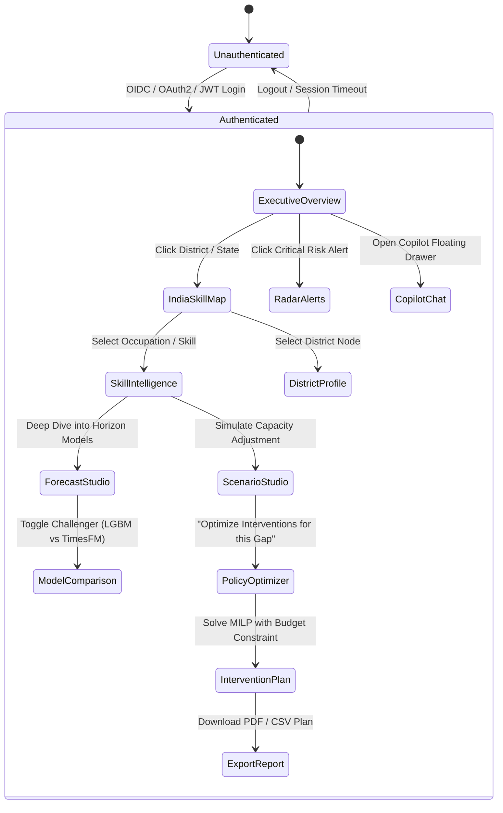

# LABREX Application Flow & State Transitions

**Document Version:** 1.0  
**Status:** Approved  

---

## 1. Master Application Flow

---

## 2. Core User Workflows

### 2.1 Workflow 1: Early-Warning to Targeted Skilling Action
1. **Trigger**: National Planner logs in and observes a **CRITICAL** alert in the **LABREX RADAR**: *"Emerging severe deficit in Solar PV Installation Technicians across Pune and Nashik districts (12-month horizon)"*.
2. **Investigation**: Planner clicks the alert card -> navigates to **India Skill Map** with Maharashtra pre-filtered.
3. **Evidence Review**: Planner examines the **Skill Intelligence** page:
   - Demand Index has risen from 42 to 89 over the past 4 quarters (driven by renewable energy manufacturing expansion).
   - Local ITI training seats remain fixed at 120 seats/year.
   - Net 12-month projected deficit: 1,450 technicians (Confidence: 88%, Agreement: HIGH).
4. **Simulation**: Planner clicks **"Test Intervention in Scenario Studio"** -> creates a scenario adding 500 seats across 4 local centres -> system computes deficit drops by 34%.
5. **Optimization**: Planner transitions to **Policy Optimizer** with a ₹2.5 Crore budget constraint -> Optimizer recommends an optimal portfolio of 600 seats expanded across 5 existing accredited centres plus 1 mobile skilling lab, achieving a 42% deficit reduction at 85% of budget.
6. **Dissemination**: Planner exports official **Policy Recommendation Report** with verifiable lineage.

### 2.2 Workflow 2: Controlled AI Copilot Analysis
1. User types in Copilot: *"Show me the top 3 emerging skill shortages in Karnataka for the next 12 months with high forecast confidence."*
2. **Execution Stage 1 (Analyzing)**: Copilot identifies intent (`get_risk_alerts`, `filters: {state: 'Karnataka', horizon: '12m', min_confidence: 0.8}`).
3. **Execution Stage 2 (Querying Data)**: System invokes backend tool `get_risk_alerts`.
4. **Execution Stage 3 (Synthesizing)**: Gemini formats the verified database payload into concise policy insights with clickable deep-links to the India Skill Map.
5. User clicks *"Run Budget Optimization for these 3 skills"* directly from Copilot suggestion chip.
