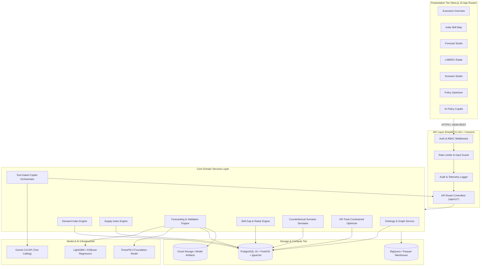

# LABREX System Architecture

**Document Version:** 1.0  
**Status:** Approved  
**Architectural Style:** High-Performance Modular Monolith + Analytical Pipelines  

---

## 1. High-Level Architecture Diagram



---

## 2. Domain Decomposition & Package Layout

LABREX is organized as an intentional modular monolith located in `backend/app/`:

```
backend/app/
├── api/                   # HTTP Route controllers (no domain business logic)
│   └── v1/
│       ├── auth.py        # Authentication & session endpoints
│       ├── geography.py   # State and district spatial endpoints
│       ├── occupations.py # NCO taxonomy & skill mappings
│       ├── demand.py      # Demand signals and indices
│       ├── supply.py      # Supply stock and training capacity
│       ├── forecasts.py   # Forecasting & model comparison
│       ├── gaps.py        # Skill-gap calculations & radar alerts
│       ├── scenarios.py   # Counterfactual simulations
│       ├── optimization.py# MILP policy intervention solver
│       ├── copilot.py     # Tool-gated Gemini copilot endpoint
│       ├── lineage.py     # Data lineage & model provenance
│       └── health.py      # Liveness, readiness, and version probes
├── core/                  # Cross-cutting foundational modules
│   ├── config.py          # Pydantic BaseSettings environment loader
│   ├── database.py        # Async SQLAlchemy engine & session factory
│   ├── security.py        # JWT verification, password hashing, RBAC
│   └── logging.py         # Structured JSON logging with trace context
├── models/                # SQLAlchemy 2.0 ORM database entity definitions
├── schemas/               # Pydantic v2 request/response validation schemas
├── services/              # Pure domain business logic & computation
│   ├── data/              # Ingestion, quality checks, ETL pipelines
│   ├── ontology/          # NCO/NSQF graph resolution & embeddings
│   ├── demand/            # Demand Index (0-100) computation
│   ├── supply/            # Supply Index (0-100) computation
│   ├── forecasting/       # Walk-forward models (Naive, LGBM, TimesFM)
│   ├── gap/               # Skill gap calculation & RADAR anomaly logic
│   ├── scenarios/         # Policy simulation engine
│   ├── optimization/      # Google OR-Tools MILP intervention solver
│   └── copilot/           # Gemini API tool router and prompt sanitizers
├── repositories/          # Data access abstractions for DB queries
└── telemetry/             # Metrics, health diagnostics, and error reporting
```

---

## 3. Data Flow & Execution Chains

### 3.1 Labour Signal to Skill-Gap Pipeline
1. Raw market signals (job vacancies, employer surveys) are ingested into `fact_job_demand`.
2. Raw skilling signals (PMKVY enrollments, ITI seat counts) are ingested into `fact_training_capacity` and `fact_training_outcomes`.
3. Ingestion quality validator computes completeness scores and maps free text to canonical NCO and NSQF entities.
4. Demand and Supply engines run nightly, generating versioned `Demand Index (0–100)` and `Supply Index (0–100)`.
5. The Forecasting engine generates 3- to 24-month horizon predictions with 80% and 95% confidence intervals using the active Champion model.
6. The Gap engine computes $\text{Gap} = \text{Demand} - \text{Supply}$ and triggers LABREX RADAR early warnings for anomalies or critical imbalances.

### 3.2 Policy Optimization Pipeline
1. Policy planner inputs fiscal budget, target district/sector, and allowed intervention types (e.g. seat expansion, new trade accreditation).
2. `OptimizationService` translates constraints into a mathematical formulation.
3. Google OR-Tools solves the MILP problem within 5 seconds.
4. Output is serialized into ranked intervention options with cost-effectiveness rankings, sensitivity bounds, and natural language explanations.
