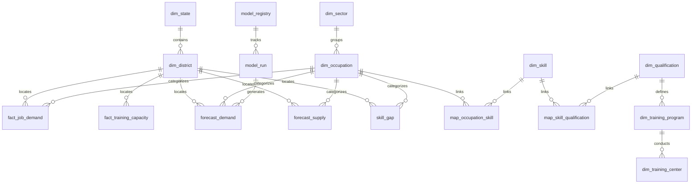

# LABREX Backend Relational & Dimensional Schema

**Database Engine:** PostgreSQL 16.15 + PostGIS + pgvector  
**Design Standard:** Migration-First (Alembic) + Append-Oriented Facts  
**Document Version:** 1.0  

---

## 1. Entity Relationship Overview

The schema is organized into **Conformed Dimensions**, **Fact Tables**, **Analytical / Forecasting Tables**, and **Governance Tables**:

---

## 2. Conformed Dimensional Entities (DDL & Column Specs)

### `dim_state`
- `state_id` (VARCHAR(10), PK): State code (e.g. `'IN-MH'`, `'IN-KA'`).
- `name` (VARCHAR(100), NOT NULL): Official state name.
- `census_code` (VARCHAR(10), UNIQUE): Official Registrar General of India code.
- `geom` (GEOMETRY(MultiPolygon, 4326)): PostGIS boundary geometry.
- `centroid` (GEOMETRY(Point, 4326)): Geographic center point.
- `created_at` (TIMESTAMPTZ, DEFAULT NOW()).

### `dim_district`
- `district_id` (VARCHAR(20), PK): Unique district code (e.g. `'IN-MH-PUN'`).
- `state_id` (VARCHAR(10), FK -> `dim_state.state_id`): Parent state.
- `name` (VARCHAR(100), NOT NULL): Official district name.
- `census_code` (VARCHAR(20)): Census district code.
- `geom` (GEOMETRY(MultiPolygon, 4326)): District boundary polygon.
- `centroid` (GEOMETRY(Point, 4326)): District centroid.
- `created_at` (TIMESTAMPTZ, DEFAULT NOW()).

### `dim_sector`
- `sector_id` (VARCHAR(20), PK): Unique code (e.g. `'SEC-AUTO'`, `'SEC-IT'`).
- `name` (VARCHAR(100), NOT NULL): Sector name (e.g. `'Automotive'`).
- `ssc_code` (VARCHAR(50)): Associated Sector Skill Council.
- `description` (TEXT).

### `dim_occupation` (NCO-2015 Hierarchy)
- `occupation_id` (VARCHAR(20), PK): Canonical occupation ID.
- `nco_code` (VARCHAR(20), NOT NULL, INDEX): Official NCO-2015 8-digit code (e.g. `'7231.0100'`).
- `title` (VARCHAR(255), NOT NULL): Canonical job title.
- `sector_id` (VARCHAR(20), FK -> `dim_sector.sector_id`).
- `division` (CHAR(1)): 1-digit major division.
- `sub_division` (CHAR(2)): 2-digit sub-division.
- `group_code` (CHAR(3)): 3-digit group.
- `family_code` (CHAR(4)): 4-digit family.
- `embedding` (VECTOR(768)): Semantic vector for text-to-occupation matching.

### `dim_skill`
- `skill_id` (VARCHAR(30), PK): Canonical skill identifier (e.g. `'SKILL-EV-BATTERY-DIAG'`).
- `name` (VARCHAR(255), NOT NULL): Standardized skill title.
- `skill_type` (VARCHAR(50)): `'TECHNICAL'`, `'FOUNDATIONAL'`, `'DIGITAL'`, `'GREEN'`.
- `description` (TEXT).
- `embedding` (VECTOR(768)): Skill description embedding.

### `dim_qualification` & `dim_nsqf_level`
- `qualification_id` (VARCHAR(50), PK): Qualification Pack ID (e.g. `'QP-ASC-Q1402'`).
- `title` (VARCHAR(255), NOT NULL): Qualification title.
- `nsqf_level` (INT, CHECK 1 <= nsqf_level <= 10): NSQF Level.
- `sector_id` (VARCHAR(20), FK -> `dim_sector.sector_id`).

### `dim_training_center`
- `center_id` (VARCHAR(50), PK): Training centre identifier.
- `district_id` (VARCHAR(20), FK -> `dim_district.district_id`).
- `name` (VARCHAR(255), NOT NULL): Centre name.
- `center_type` (VARCHAR(50)): `'ITI'`, `'PMKVY_KENDRA'`, `'POLYTECHNIC'`, `'PRIVATE_VTP'`.
- `geom` (GEOMETRY(Point, 4326)): Physical GPS coordinates.
- `is_accredited` (BOOLEAN, DEFAULT TRUE).

---

## 3. Fact Tables (Append-Oriented Signals)

### `fact_job_demand`
- `demand_fact_id` (BIGSERIAL, PK).
- `date_key` (DATE, NOT NULL, INDEX): Observation month / period.
- `district_id` (VARCHAR(20), FK -> `dim_district.district_id`, NOT NULL).
- `occupation_id` (VARCHAR(20), FK -> `dim_occupation.occupation_id`, NOT NULL).
- `active_postings` (INT, NOT NULL, DEFAULT 0).
- `new_postings` (INT, NOT NULL, DEFAULT 0).
- `median_days_open` (INT, DEFAULT 0): Vacancy persistence.
- `unique_employers` (INT, DEFAULT 0): Employer diversity.
- `data_source` (VARCHAR(50), NOT NULL): `'NCS'`, `'JOB_PORTAL'`, `'DEMO_FIXTURE'`.
- `dataset_type` (VARCHAR(20), NOT NULL): `'REAL'`, `'DERIVED'`, `'SYNTHETIC'`.
- `created_at` (TIMESTAMPTZ, DEFAULT NOW()).

### `fact_training_capacity` & `fact_training_outcomes`
- `capacity_fact_id` (BIGSERIAL, PK).
- `period_start` (DATE, NOT NULL).
- `center_id` (VARCHAR(50), FK -> `dim_training_center.center_id`, NOT NULL).
- `qualification_id` (VARCHAR(50), FK -> `dim_qualification.qualification_id`, NOT NULL).
- `sanctioned_seats` (INT, NOT NULL, DEFAULT 0).
- `enrolled_trainees` (INT, NOT NULL, DEFAULT 0).
- `completed_trainees` (INT, DEFAULT 0).
- `certified_trainees` (INT, DEFAULT 0).
- `placed_trainees` (INT, DEFAULT 0).
- `dataset_type` (VARCHAR(20), NOT NULL): `'REAL'`, `'SYNTHETIC'`.

---

## 4. Analytical, Forecast & Intelligence Tables

### `forecast_demand` & `forecast_supply`
- `forecast_id` (BIGSERIAL, PK).
- `model_run_id` (UUID, NOT NULL).
- `district_id` (VARCHAR(20), FK -> `dim_district.district_id`, NOT NULL).
- `occupation_id` (VARCHAR(20), FK -> `dim_occupation.occupation_id`, NOT NULL).
- `forecast_date` (DATE, NOT NULL): Future projected date.
- `horizon_months` (INT, NOT NULL): 3, 6, 12, 18, 24.
- `point_estimate` (NUMERIC(12, 2), NOT NULL).
- `lower_bound_80` (NUMERIC(12, 2), NOT NULL).
- `upper_bound_80` (NUMERIC(12, 2), NOT NULL).
- `lower_bound_95` (NUMERIC(12, 2), NOT NULL).
- `upper_bound_95` (NUMERIC(12, 2), NOT NULL).
- `model_name` (VARCHAR(50), NOT NULL): `'SEASONAL_NAIVE'`, `'LIGHTGBM'`, `'TIMESFM-3'`.
- `is_champion` (BOOLEAN, DEFAULT FALSE).
- `created_at` (TIMESTAMPTZ, DEFAULT NOW()).

### `skill_gap` & `risk_alert`
- `gap_id` (BIGSERIAL, PK).
- `district_id` (VARCHAR(20), NOT NULL).
- `occupation_id` (VARCHAR(20), NOT NULL).
- `forecast_horizon` (INT, NOT NULL).
- `demand_index` (NUMERIC(5, 2), CHECK 0 <= demand_index <= 100).
- `supply_index` (NUMERIC(5, 2), CHECK 0 <= supply_index <= 100).
- `projected_gap` (NUMERIC(12, 2), NOT NULL): $\text{Demand} - \text{Supply}$.
- `gap_growth_rate` (NUMERIC(6, 4)).
- `confidence_score` (NUMERIC(4, 3), CHECK 0 <= confidence_score <= 1.0).
- `model_agreement` (VARCHAR(20)): `'HIGH'`, `'MEDIUM'`, `'LOW'`.
- `risk_class` (VARCHAR(20), NOT NULL): `'CRITICAL'`, `'HIGH'`, `'EMERGING'`, `'WATCH'`, `'NORMAL'`, `'OVERSUPPLY'`.

### `scenario` & `optimization_run`
- `scenario_id` (UUID, PK).
- `user_id` (UUID, NOT NULL).
- `title` (VARCHAR(255), NOT NULL).
- `parameters` (JSONB, NOT NULL): Shift multipliers, capacity adds.
- `results_summary` (JSONB, NOT NULL): Net gap delta, budget impact.
- `created_at` (TIMESTAMPTZ, DEFAULT NOW()).

### `optimization_run`
- `run_id` (UUID, PK).
- `user_id` (UUID, NOT NULL).
- `budget_inr` (NUMERIC(15, 2), NOT NULL).
- `solver_status` (VARCHAR(50)): `'OPTIMAL'`, `'FEASIBLE'`, `'INFEASIBLE'`.
- `objective_value` (NUMERIC(15, 2)): Minimized deficit score.
- `recommended_interventions` (JSONB, NOT NULL): List of center/trade expansions.
- `tradeoff_analysis` (JSONB).
- `solve_time_ms` (INT).
- `created_at` (TIMESTAMPTZ, DEFAULT NOW()).

---

## 5. Audit & Governance Tables

### `model_registry` & `model_run`
- `model_id` (VARCHAR(50), PK): `'LGBM_DEMAND_REGRESSOR_V1'`.
- `model_type` (VARCHAR(50)): `'TREE_ENSEMBLE'`, `'FOUNDATION_TS'`, `'HEURISTIC'`.
- `status` (VARCHAR(20)): `'CANDIDATE'`, `'CHAMPION'`, `'RETIRED'`.
- `validation_mae` (NUMERIC(10, 4)).
- `validation_wape` (NUMERIC(10, 4)).
- `coverage_80` (NUMERIC(6, 4)).

### `audit_logs`
- `log_id` (BIGSERIAL, PK).
- `user_id` (UUID).
- `action` (VARCHAR(100), NOT NULL): `'RUN_OPTIMIZATION'`, `'TRIGGER_INGESTION'`.
- `resource` (VARCHAR(100)).
- `details` (JSONB).
- `ip_address` (VARCHAR(45)).
- `created_at` (TIMESTAMPTZ, DEFAULT NOW()).
