# LABREX Data Architecture & Pipeline Engineering

**Document Version:** 1.0  
**Design Pattern:** Layered Medallion Architecture (Raw -> Bronze -> Silver -> Gold -> Feature -> Model -> Serving)  
**Strict Rule:** Data layers must never be mixed or bypassed.  

---

## 1. Architectural Layers Overview

```mermaid
flowchart TD
    subgraph L0["RAW LAYER (Storage/Files)"]
        R1["NCS Vacancy Dumps (.json/.csv)"]
        R2["PLFS Microdata (Stata/CSV)"]
        R3["PMKVY / DGT Portals (.xlsx/.json)"]
        R4["e-Shram Aggregate Registrations"]
    end

    subgraph L1["BRONZE LAYER (PostgreSQL / Staging)"]
        B1["stg_raw_job_postings"]
        B2["stg_raw_training_records"]
        B3["stg_raw_survey_responses"]
    end

    subgraph L2["SILVER LAYER (Cleaned & Normalized)"]
        S1["clean_job_vacancies (deduped, text cleaned)"]
        S2["clean_training_enrollments (standardized QP)"]
        S3["clean_worker_registry (mapped to NCO)"]
    end

    subgraph L3["GOLD LAYER (Conformed Dimensional Core)"]
        G1["dim_state / dim_district (PostGIS geom)"]
        G2["dim_occupation / dim_skill (NCO & NSQF)"]
        G3["fact_job_demand (monthly aggregations)"]
        G4["fact_training_capacity / fact_training_outcomes"]
    end

    subgraph L4["FEATURE LAYER (ML & Analytics)"]
        F1["feat_demand_timeseries (lags, momentum, rolling means)"]
        F2["feat_supply_pipeline (seat density, completion rates)"]
    end

    subgraph L5["MODEL & SERVING LAYER"]
        M1["forecast_demand (walk-forward estimates, intervals)"]
        M2["forecast_supply (pipeline capacity forecasts)"]
        M3["skill_gap (net deficit, risk classification)"]
        M4["serving_dashboard_views (pre-aggregated API cache)"]
    end

    L0 -->|Ingest with hash & audit| L1
    L1 -->|Validate schema, cleanse, map taxonomy| L2
    L2 -->|Transform to conformed dimensions & facts| L3
    L3 -->|Feature engineering pipelines| L4
    L4 -->|Model inference & validation| L5
```

---

## 2. Layer Specification & Ingestion Contracts

### Layer 0: Raw
- **Storage Target**: Local file store (`data/raw/`) or Google Cloud Storage (`gs://labrex-data-raw/`).
- **Characteristics**: Untouched, read-only copies of source feeds with checksums (`sha256`), ingest timestamps, and source headers.

### Layer 1: Bronze (Staging)
- **Format**: Database staging tables with JSONB payloads preserving all raw attributes.
- **Contract**: Every row receives `ingest_batch_id`, `source_id`, `row_hash`, and `ingested_at`.
- **Idempotency**: Ingestion ignores duplicate rows matching existing `(source_id, row_hash)`.

### Layer 2: Silver (Standardized & Cleansed)
- **Transformations**:
  - Deduplication: Identification of repeated job postings across portals based on employer, title, and district.
  - Text Normalization: Lowercasing, punctuation stripping, and tokenization.
  - Taxonomical Mapping: Free-text job roles resolved to canonical NCO-2015 codes with embedding confidence scores. Mappings with confidence < 0.65 are routed to human review (`flag_review = TRUE`).

### Layer 3: Gold (Enterprise Dimensional Store)
- **Format**: Star schema defined in `docs/BACKEND_SCHEMA.md`.
- **Aggregations**: Monthly and quarterly aggregates by `(district_id, occupation_id, sector_id)`.

### Layer 4: Feature Engineering
- **Temporal Features**: 1-month, 3-month, 6-month, and 12-month lag values for active postings and trainee completions.
- **Momentum Features**: Rate of acceleration $\frac{\Delta \text{Demand}}{\Delta t}$.
- **Structural Features**: District industrial density, presence of anchor manufacturing plants, and active training centres.

### Layer 5: Model & Serving
- **Predictions**: Point forecasts with 80% and 95% prediction intervals.
- **Pre-computed Serving Views**: Materialized views for high-frequency queries (`vw_district_radar_summary`, `vw_state_kpi_overview`) refreshed asynchronously.

---

## 3. Data Lineage & Provenance Tracking

Every record in the serving layer carries:
1. `source_dataset_version`: Identifier of the underlying raw batch.
2. `pipeline_version`: Version of the ETL/NLP transformation code.
3. `model_version`: Unique model registry ID that generated the forecast.
4. `calculation_timestamp`: UTC execution time.
