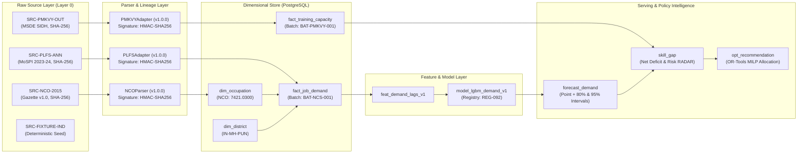

# LABREX Data Lineage & Provenance Architecture

**Document Version:** 2.0  
**Authority:** Master Directive Section 13, 47, 79 & Secondary Mandate Step 13  
**Standard:** Every metric displayed on the platform is cryptographically traceable to its raw source batch.  
**Compliance Standard:** ISO/IEC 25012 Data Quality & W3C PROV-O Standard.

---

## 1. Lineage Graph Model



---

## 2. Ingestion Lineage Contract (`IngestionLineage`)

Every batch ingested through `backend/app/services/data/` creates an immutable `IngestionLineage` record:

```python
class IngestionLineage(BaseModel):
    source_id: str             # e.g. 'SRC-PLFS-ANN', 'SRC-PMKVY-OUT'
    dataset_name: str          # Official dataset name
    dataset_version: str       # e.g. 'PLFS-2023-24', 'PMKVY-4.0'
    parser_name: str           # e.g. 'PLFSAdapter'
    parser_version: str        # e.g. '1.0.0'
    retrieved_at: datetime     # UTC timestamp
    file_path: Optional[str]   # Relative path in data/raw/
    file_sha256: Optional[str] # Streaming SHA-256 digest of source file
    batch_id: str              # Unique UUIDv4 batch ID
    lineage_signature: str     # Cryptographic provenance signature
```

### 2.1 Cryptographic Signature Formulation
The lineage signature guarantees batch authenticity and prevents silent tampering:

$$\text{LineageSignature} = \text{SHA-256}\left(\text{source\_id} \parallel \text{dataset\_version} \parallel \text{batch\_id} \parallel \text{file\_sha256}\right)$$

---

## 3. Serving-Layer Provenance Payload

Every entity in the API response exposes an auditable provenance structure:

```json
{
  "entity_id": "gap-IN-MH-PUN-7421-0300-12m",
  "metric_name": "Projected 12-Month Skill Gap",
  "value": 1450,
  "provenance": {
    "demand_forecast": {
      "model_id": "REG-LGBM-DEMAND-V1",
      "model_run_id": "run-8f3a1-94bc-45",
      "training_dataset_version": "GOLD_2025_Q3",
      "algorithm": "LightGBM Regressor (Tuned Lags)",
      "validation_wape": 0.089
    },
    "supply_forecast": {
      "source_tables": ["fact_training_capacity", "fact_training_outcomes"],
      "batch_ids": ["BAT-PMKVY-2024-Q3"],
      "effective_pipeline_discount": 0.85
    },
    "ontology_mappings": {
      "occupation_title": "Solar PV Installation Technician",
      "nco_code": "7421.0300",
      "mapping_method": "DETERMINISTIC_EXACT_MATCH"
    },
    "lineage_signature": "8f3e2b9c71a...",
    "calculation_timestamp": "2026-10-20T10:30:00Z"
  }
}
```

---

## 4. Immutability & Traceability Invariants

1. **Append-Only Staging**: Raw records and bronze payloads are never overwritten or mutated in place. New runs receive an incremented `batch_id`.
2. **Deterministic Reproducibility**: Given a model version, feature pipeline version, and source batch ID, the exact forecast point estimates and intervals can be reproduced identically.
3. **Quality-Driven Confidence Discounting**: Batches receiving a Data Quality Score $< 85$ carry explicit confidence penalties that widen forecast prediction intervals.
