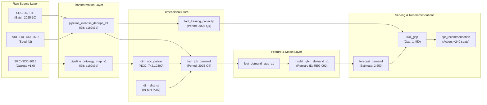

# LABREX Data Lineage & Provenance Architecture

**Document Version:** 1.0  
**Authority:** Master Directive Section 13, 47 & 79  
**Standard:** Every metric displayed on the dashboard must be traceable to its origin.  

---

## 1. Lineage Graph Model



---

## 2. Lineage Metadata Attributes

Every data entity in the serving tier exposes a `get_lineage()` metadata payload:

```json
{
  "entity_id": "gap-IN-MH-PUN-7421-0300-12m",
  "metric_name": "Projected 12-Month Skill Gap",
  "value": 1450,
  "provenance": {
    "demand_forecast": {
      "model_id": "REG-LGBM-DEMAND-V1",
      "model_run_id": "run-8f3a1-...",
      "training_dataset_version": "GOLD_2025_Q3",
      "algorithm": "LightGBM Regressor (Tuned Lags)",
      "validation_wape": 0.089
    },
    "supply_forecast": {
      "source_tables": ["fact_training_capacity", "fact_training_outcomes"],
      "batch_ids": ["BAT-DGT-2025-10"],
      "effective_pipeline_discount": 0.85
    },
    "ontology_mappings": {
      "occupation_title": "Solar PV Installation Technician",
      "nco_code": "7421.0300",
      "mapping_method": "DETERMINISTIC_EXACT_MATCH"
    },
    "calculation_timestamp": "2026-10-20T10:30:00Z"
  }
}
```

---

## 3. Immutability & Traceability Invariants

1. **Append-Only Historical Ingestion**: Fact tables are strictly append-only. Reprocessed data creates new versions with incremented `batch_id` without destructive overwrite.
2. **Deterministic Reproducibility**: Given a model version, feature pipeline version, and source batch ID, the exact forecast point estimates and intervals can be reproduced identically.
3. **Data Quality Attestation**: Datasets with a quality score < 70 receive an explicit discount in the confidence engine, propagating to wider forecast uncertainty bands.
