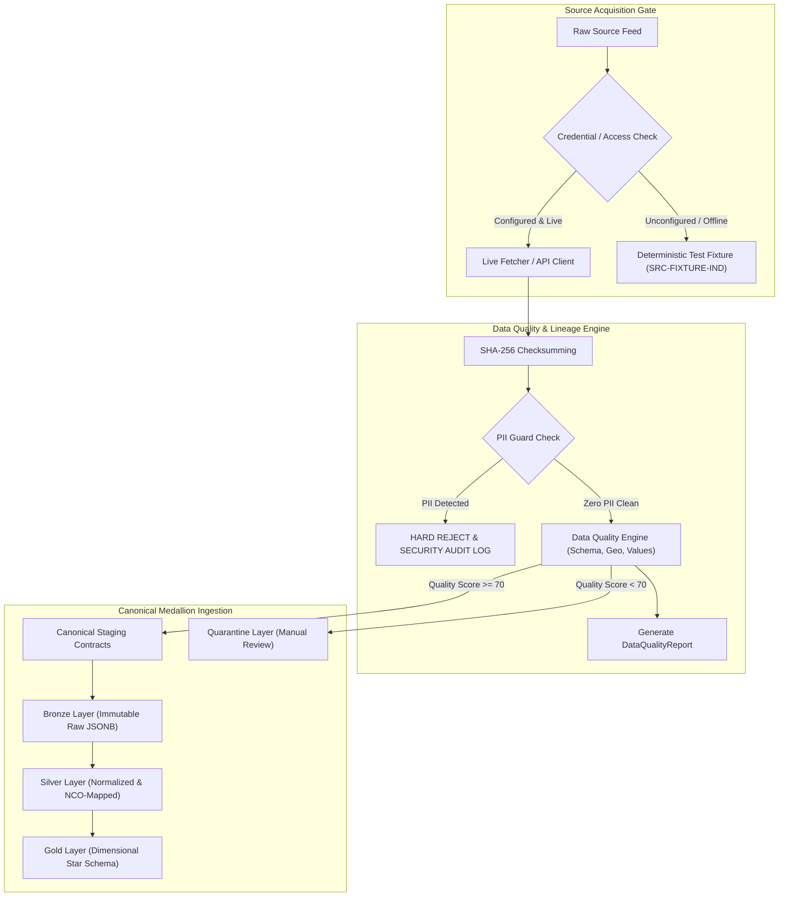

# LABREX Data Source Registry

**Document Version:** 2.0  
**Authority:** Master Directive Section 14, 93 & Secondary Ingestion Mandate  
**Integrity Rule:** Synthetic and demo datasets are explicitly tagged. Never fabricate government data. Never classify a source as "API Available" unless an active, verified API endpoint and authentication method are confirmed.  
**Compliance Standard:** ISO/IEC 25012 Data Quality & MoSPI National Data Sharing and Accessibility Policy (NDSAP).

---

## 1. Registry Master Summary Table

| Source ID | Dataset Name | Authority / Ministry | Official URL | Access Method | Format | Frequency | Geographic Granularity | Temporal Granularity | Personal-Data Risk | Freshness | Availability State | Ingestion Status |
| :--- | :--- | :--- | :--- | :--- | :--- | :--- | :--- | :--- | :--- | :--- | :--- | :--- |
| `SRC-NCO-2015` | National Classification of Occupations 2015 (Vol I & II) | MoLE / DGE | `https://labour.gov.in/national-classification-occupations-nco` | Public Document / OGD Portal | PDF / CSV / XLSX | Static (2015 Edition) | National (Taxonomy) | Decadal standard | NONE (Zero PII) | High (Current Standard) | HIGH (Publicly Hosted) | **PARSER_READY** |
| `SRC-PLFS-ANN` | Periodic Labour Force Survey — Annual & Quarterly | MoSPI / NSSO | `https://microdata.gov.in/` | Microdata Portal / Annual Reports | CSV / XLSX / Fixed-width TXT | Annual (July-June) & Quarterly Urban | National, State/UT, NSS Region, Select Districts | Annual / Quarterly | NONE (Published aggregates / De-identified microdata) | Moderate (2023–24 Round) | HIGH (Public Download) | **ADAPTER_READY** |
| `SRC-NCS-FEED` | National Career Service Vacancy & Job Postings | MoLE / NCS | `https://www.ncs.gov.in/` | Gated Ministry API / OGD Monthly Releases (No scraping) | JSON (API) / CSV (Batch) | Continuous (API) / Monthly (Batch) | State, District, Industry Sector, NCO 8-digit | Daily / Bi-weekly / Monthly | LOW (Employer posting details; Worker PII barred) | Near Real-time (API) / Monthly (Batch) | CONFIG_GATED (`NOT_CONFIGURED` locally) | **PLUGGABLE_ADAPTER_READY** |
| `SRC-ESHRAM-AGG` | e-Shram Unorganized Worker Dashboard Aggregates | MoLE | `https://eshram.gov.in/` | Public Dashboard Export / Lok Sabha Releases (No worker PII) | CSV / XLSX / JSON (Dashboard) | Monthly snapshots | State, District, Primary Occupation (NCO 2/4-digit) | Monthly Cumulative | HIGH if raw microdata; **NONE** for public district aggregates used | Monthly | MEDIUM (Manual Dashboard Extract) | **AGGREGATE_ADAPTER_READY** |
| `SRC-PMKVY-OUT` | PMKVY 1.0–4.0 Enrolled, Trained, Certified & Placed | MSDE / NSDC | `https://www.pmkvyofficial.org/` | MSDE Open Data / SIDH Portal Reports | CSV / XLSX | Quarterly / Scheme Phase | State, District, SSC, Qualification Pack (QP) | Quarterly / Financial Year | NONE (District aggregate statistics) | High (PMKVY 4.0 Active) | HIGH (Open Government Download) | **PIPELINE_ADAPTER_READY** |
| `SRC-NSDC-DIR` | NSDC Training Partner & Centre Directory | NSDC / NCVET | `https://nsdcindia.org/` | National Qualification Register (NQR) / SIDH Directory | CSV / JSON / XLSX | Quarterly | District, Training Centre, NSQF Level, Scheme | Quarterly Active Roster | NONE (Public institutional directory) | High (Current Active) | HIGH (Public Directory Listing) | **DIRECTORY_ADAPTER_READY** |
| `SRC-GEO-ADMIN` | Survey of India / LGD Administrative Boundaries | Survey of India / MoPR (LGD) | `https://lgdirectory.gov.in/` | Survey of India Open Data / Bharat Maps / LGD API | GeoJSON / Shapefile / CSV | Annual / As gazetted | National, 36 States/UTs, 780+ Districts, Sub-districts | Census 2011 + 2024 LGD Gazettes | NONE (Geospatial polygons) | High (2024 LGD Master) | HIGH (Official Vector Boundary) | **GEO_PARSER_READY** |
| `SRC-DGT-ITI` | ITI Accreditation, Trades & Seating Capacity | DGT / NCVT | `https://ncvtmis.gov.in/` | NCVT MIS Public Statistics | CSV / XLSX | Annual | State, District, ITI Code, Trade (NCO mapped) | Academic Year | NONE (Institutional capacity) | High (2024–25 Roster) | HIGH (Public Portal Tables) | **SCHEMA_ALIGNED** |
| `SRC-FIXTURE-IND` | LABREX Deterministic Test & Development Fixture | LABREX Engineering | Internal Repository (`data/fixtures/`) | Deterministic Local JSON / GeoJSON | JSON / GeoJSON | Seeded Static | 3 Sample States, 18 Sample Districts | 2024–2026 Monthly Panels | NONE (100% Synthetic / Mock) | Deterministic | IMMEDIATE | **VERIFIED_FIXTURE** |

---

## 2. Granular Source Dossiers

### 2.1 `SRC-NCO-2015`: National Classification of Occupations 2015
- **Authority**: Ministry of Labour & Employment (MoLE), Directorate General of Employment (DGE), Government of India.
- **Dataset Name**: National Classification of Occupations — 2015 (Volume I: Code Structure & Volume II: Occupational Descriptions).
- **Official URL**: `https://labour.gov.in/national-classification-occupations-nco`
- **Access Method**: Official Gazetted publication, downloadable PDF volumes and OGD machine-readable tables.
- **Download Format**: PDF (official text), structured CSV / XLSX tables.
- **Update Frequency**: Static standard revision (2015 Edition, aligned internationally to ISCO-08).
- **Geographic Granularity**: National taxonomy (all-India applicability across formal and informal trades).
- **Temporal Granularity**: Decadal reference standard.
- **License / Usage Notes**: Open Government Data (OGD) License India. Free for public policy, research, and technical implementations.
- **Personal-Data Risk**: **ZERO**. Pure taxonomical ontology. Contains no individual identities, biometric information, or telemetry.
- **Freshness**: Authoritative baseline standard currently mandated for NCS, e-Shram, and Skill India Digital Hub.
- **Availability State**: **HIGH**. Unrestricted public access.
- **Ingestion Status**: `PARSER_READY`. Preprocessor parses 1-digit Division, 2-digit Sub-Division, 3-digit Group, 4-digit Family, and 8-digit Occupation with mapped sector context.

---

### 2.2 `SRC-PLFS-ANN`: Periodic Labour Force Survey
- **Authority**: Ministry of Statistics and Programme Implementation (MoSPI), National Sample Survey Office (NSSO).
- **Dataset Name**: Periodic Labour Force Survey (PLFS) — Annual Report (Rural + Urban) and Quarterly Bulletins (Urban).
- **Official URL**: `https://microdata.gov.in/mop/` and `https://www.mospi.gov.in/`
- **Access Method**: MoSPI Microdata Portal (user registration required for raw unit-level microdata) and MoSPI Annual Report Tabular Releases (direct public download).
- **Download Format**: Tabular XLSX/CSV reports; unit-level raw data available in Fixed-Width ASCII Text (.TXT) with layout dictionary (.do / .sps / .pdf layout sheets).
- **Update Frequency**: 
  - Annual: July to June survey cycle (published annually with 6–9 months latency).
  - Quarterly: Urban sector indicator bulletins (published ~3 months post-quarter).
- **Geographic Granularity**: National, State/Union Territory, NSS Region. Note: District-level indicators are published only for sample-sufficient districts in large states; rural districts require small-area estimation or state-level pooling.
- **Temporal Granularity**: Annual (52-week panel) and Quarterly (Urban rotation panel).
- **License / Usage Notes**: National Data Sharing and Accessibility Policy (NDSAP). Authorized for non-commercial statistical analytics. Attribution to MoSPI mandatory.
- **Personal-Data Risk**: **NONE**. Published tables are strictly aggregates. Unit-level microdata is anonymized by NSSO with masked primary sampling unit (FSU) keys.
- **Freshness**: Latest completed annual report: 2023–24 (released October 2024); quarterly urban bulletin: April–June 2024.
- **Availability State**: **HIGH** for tabular reports; **RESTRICTED_PORTAL** for raw unit-level microdata download.
- **Ingestion Status**: `ADAPTER_READY`. Targeted minimal indicators extracted:
  1. Labour Force Participation Rate (LFPR) by State / Sector / Gender.
  2. Worker Population Ratio (WPR).
  3. Unemployment Rate (UR).
  4. Broad Industry & Occupation percentage distributions (NIC-2008 & NCO 1/2-digit).

---

### 2.3 `SRC-NCS-FEED`: National Career Service Job Vacancies
- **Authority**: Ministry of Labour & Employment (MoLE), National Career Service (NCS) Project.
- **Dataset Name**: NCS Active Job Postings, Vacancies, and Industry Demand Signals.
- **Official URL**: `https://www.ncs.gov.in/`
- **Access Method**:
  - Gated API: Ministry REST API for accredited state portals, research institutes, and B2B partners (`https://api.ncs.gov.in/`).
  - Open Data Extracts: Periodic aggregated datasets published on `https://data.gov.in/`.
  - **Strict Policy**: No unauthorized web scraping or bypassing of captcha/rate limits.
- **Download Format**: JSON (REST API response) or CSV/ZIP (batch data releases).
- **Update Frequency**: Continuous / Daily via authenticated API; Monthly / Bi-weekly via OGD batch extracts.
- **Geographic Granularity**: State, District, Pin Code (where provided), Sector Skill Council domain.
- **Temporal Granularity**: Daily timestamped job postings; monthly vacancy aggregates.
- **License / Usage Notes**: Ministry of Labour & Employment terms of access. Aggregated market insights permitted; redistribution of raw employer contacts prohibited.
- **Personal-Data Risk**: **LOW**. Ingestion filters out employer individual phone numbers, applicant CVs, and contact emails. Only job vacancy attributes (NCO code, title, salary band, min education, district, expiration date) are ingested.
- **Freshness**: Real-time when API credentials are live; 30-day lag for public batch extracts.
- **Availability State**: `CONFIG_GATED`. Defaults to `NOT_CONFIGURED` in offline/local environments; gracefully handles `AVAILABLE`, `RATE_LIMITED`, and `UNAVAILABLE`.
- **Ingestion Status**: `PLUGGABLE_ADAPTER_READY`.

---

### 2.4 `SRC-ESHRAM-AGG`: e-Shram Unorganized Worker Dashboard Aggregates
- **Authority**: Ministry of Labour & Employment (MoLE).
- **Dataset Name**: e-Shram National Database of Unorganised Workers — Public Dashboard Aggregates.
- **Official URL**: `https://eshram.gov.in/eshramportal/publicDashboard`
- **Access Method**: Public analytics dashboard export / Parliamentary answers (Lok Sabha / Rajya Sabha) / MoLE Year-End Reviews.
- **Download Format**: CSV / XLSX / JSON (Dashboard summary cards).
- **Update Frequency**: Monthly cumulative updates.
- **Geographic Granularity**: State / UT and District level.
- **Temporal Granularity**: Monthly snapshot timestamps.
- **License / Usage Notes**: Public domain government dashboard statistics.
- **Personal-Data Risk**: **CRITICAL GUARD**: 
  - Raw e-Shram microdata contains Aadhaar seeds, bank account linkages, and personal identities.
  - **LABREX MANDATE**: Under no circumstances shall individual e-Shram worker records, Aadhaar numbers, or PII be ingested or stored.
  - LABREX ingests **ONLY** public district-level and sector-level aggregate counts. The pipeline rejects any incoming record containing PII fields.
- **Freshness**: Cumulative registrations exceeding 300 million workers across India as of 2024.
- **Availability State**: **MEDIUM**. Aggregates are public on web dashboards; batch download requires periodic manual export or parliamentary annexures.
- **Ingestion Status**: `AGGREGATE_ADAPTER_READY`. Records: `snapshot_date`, `state_code`, `district_code`, `occupation_sector`, `worker_count`, `gender_ratio`, `dataset_version`.

---

### 2.5 `SRC-PMKVY-OUT`: Pradhan Mantri Kaushal Vikas Yojana (PMKVY)
- **Authority**: Ministry of Skill Development and Entrepreneurship (MSDE) & National Skill Development Corporation (NSDC).
- **Dataset Name**: PMKVY Short Term Training (STT) and Recognition of Prior Learning (RPL) Metrics.
- **Official URL**: `https://www.pmkvyofficial.org/` and `https://www.skillindiadigital.gov.in/`
- **Access Method**: MSDE Open Data Reports, Lok Sabha / Rajya Sabha parliamentary disclosures, Skill India Digital Hub dashboards.
- **Download Format**: CSV / XLSX.
- **Update Frequency**: Quarterly / Scheme Phase (PMKVY 1.0, 2.0, 3.0, 4.0).
- **Geographic Granularity**: State and District level.
- **Temporal Granularity**: Financial Year / Cumulative Quarter.
- **License / Usage Notes**: Open Government Data License India.
- **Personal-Data Risk**: **ZERO**. Statistics are aggregated counts by district and qualification.
- **Freshness**: High. Covers historical completions (2016–2023) and active PMKVY 4.0 cohorts.
- **Availability State**: **HIGH**. Regularly published in parliamentary replies and MSDE annual reports.
- **Ingestion Status**: `PIPELINE_ADAPTER_READY`. The adapter cleanly separates:
  1. `TrainingPipeline`: Currently enrolled candidates in active batches.
  2. `CertifiedSupply`: Successfully assessed and certified candidates (effective supply).
  3. `PlacedWorkforce`: Formally placed or self-employed tracked candidates.
  4. `InfrastructureCapacity`: Accredited centres and allocated seat capacities.

---

### 2.6 `SRC-NSDC-DIR`: NSDC Skill Directory & Training Centre Roster
- **Authority**: National Skill Development Corporation (NSDC) / National Council for Vocational Education and Training (NCVET).
- **Dataset Name**: Accredited Training Center Directory & National Qualification Register (NQR).
- **Official URL**: `https://nsdcindia.org/` and `https://nqr.gov.in/`
- **Access Method**: Public web directory download / NQR open register exports.
- **Download Format**: CSV / JSON / XLSX.
- **Update Frequency**: Quarterly.
- **Geographic Granularity**: District, Town/City, Training Centre PIN code.
- **Temporal Granularity**: Active registry status at snapshot date.
- **License / Usage Notes**: Public directory for student guidance and institutional accreditation.
- **Personal-Data Risk**: **ZERO**. Institutional business addresses, contact POCs for centres, and QP lists only.
- **Freshness**: Reflects currently accredited Private VTPs, PMKKs (Pradhan Mantri Kaushal Kendras), and partner institutions.
- **Availability State**: **HIGH**. Publicly accessible catalog.
- **Ingestion Status**: `DIRECTORY_ADAPTER_READY`. Extracts: `center_id`, `name`, `district_id`, `state_id`, `center_type`, `accreditation_status`, `sanctioned_capacity`, `course_offerings`.

---

### 2.7 `SRC-GEO-ADMIN`: Indian Administrative Boundary Reference Data
- **Authority**: Survey of India (SOI) & Ministry of Panchayati Raj (Local Government Directory - LGD).
- **Dataset Name**: Official Boundary Polygons of India — States, Union Territories, and Districts.
- **Official URL**: `https://lgdirectory.gov.in/` and `https://onlinemaps.surveyofindia.gov.in/`
- **Access Method**: Survey of India Open Map Series, Bharat Maps (NIC), and LGD standardized master directory.
- **Download Format**: GeoJSON / Shapefile (.shp) / TopoJSON.
- **Update Frequency**: Annual or upon official state delimitation / district bifurcations.
- **Geographic Granularity**: National, 36 States/UTs, 780+ Districts.
- **Temporal Granularity**: Census 2011 baseline + 2024 LGD gazetted administrative reorganizations.
- **License / Usage Notes**: Survey of India National Map Policy (2021 Geospatial Guidelines). Free for Indian entities and platforms within territorial boundaries of India.
- **Personal-Data Risk**: **ZERO**. Spatial boundary geometries.
- **Freshness**: 2024 LGD hierarchy codes.
- **Availability State**: **HIGH**.
- **Ingestion Status**: `GEO_PARSER_READY`. Validates:
  1. Geometry validity (`is_valid`, non-empty, exterior closed ring).
  2. Spatial Reference Identifier: EPSG:4326 (WGS84) standard.
  3. Strict Parent-Child relational hierarchy (`district.state_id == state.state_id`).

---

## 3. Ingestion Governance & Fallback Architecture

Every ingestion run generates an auditable record containing:
- `ingest_batch_id`: UUIDv4
- `source_id`: Master Registry key
- `retrieval_timestamp`: UTC ISO 8601
- `file_sha256`: Cryptographic digest of source file
- `record_count`: Ingested records count
- `quality_score`: 0 to 100 aggregate score
- `lineage_signature`: HMAC-SHA256 of batch provenance metadata.
