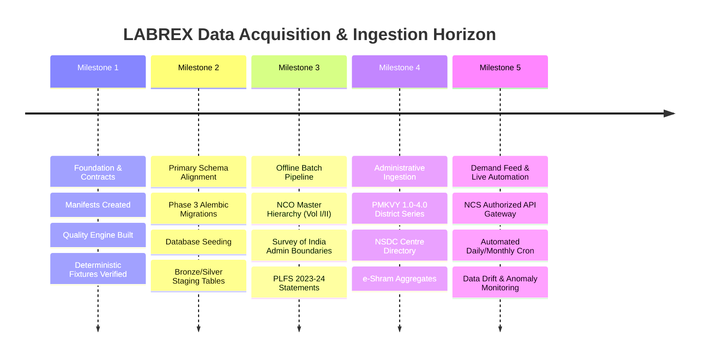

# LABREX Data Ingestion Implementation Roadmap

**Document Version:** 1.0  
**Authority:** Secondary Data Intelligence Engineering Loop Mandate  
**Scope:** Chronological Roadmap for Production Data Ingestion & Integration  
**Dependencies:** Phase 3 Dimensional Schema Completion (`dim_*`, `fact_*`)

---

## 1. Roadmap Overview & Timeline

---

## 2. Phased Ingestion Schedule

### Phase A: Foundation & Staging Contracts (COMPLETED)
- [x] Author comprehensive `docs/DATA_SOURCE_REGISTRY.md` with verified access methods.
- [x] Create download manifests in `data/manifests/*.yaml`.
- [x] Scaffold `data/raw/` with isolated README directives.
- [x] Implement canonical decoupled schemas in `backend/app/schemas/staging.py`.
- [x] Build automated `DataQualityEngine` and `IngestionLineage` cryptographic tracker.
- [x] Implement parsers & adapters: NCO, PLFS, e-Shram, PMKVY, NSDC, NCS, Geography.
- [x] Create deterministic test fixtures in `data/fixtures/` and test verification suite.

### Phase B: Dimensional Schema Landing (Post-Phase 3)
- [ ] Connect `CanonicalOccupation` -> `dim_occupation` with vector embeddings (768-dim).
- [ ] Connect `GeographyValidationResult` -> PostGIS tables `dim_state` and `dim_district`.
- [ ] Connect `CanonicalObservation` -> `fact_job_demand`.
- [ ] Connect `CanonicalTrainingSignal` -> `fact_training_capacity` & `fact_training_outcomes`.
- [ ] Connect `CanonicalWorkforceSignal` -> `fact_workforce_stock` & `fact_workforce_indicators`.

### Phase C: Historical Baseline Bulk Load
- [ ] Ingest full gazetted NCO-2015 taxonomy (Volume I & II).
- [ ] Ingest official Survey of India boundary polygons (36 States/UTs, 780+ Districts).
- [ ] Ingest PLFS 2021–22, 2022–23, and 2023–24 state-level labour force indicators.
- [ ] Ingest PMKVY 1.0 to PMKVY 3.0 cumulative district outcomes.

### Phase D: Operational Automation & Gated Feeds
- [ ] Configure live NCS API client with ministry credentials.
- [ ] Implement monthly Cloud Scheduler trigger for e-Shram public dashboard extracts.
- [ ] Wire automated data quality gate to send Slack / email alerts on `QualityScore < 85`.
- [ ] Implement automated feature refresh pipeline (`feat_demand_timeseries`, `feat_supply_pipeline`).

---

## 3. Governance & Audit Protocols

1. **Pre-Ingestion Check**:
   - Operator computes `file_sha256` and verifies against `data/manifests/<source>.yaml`.
   - Operator runs `scripts/secret_guard.py` to ensure zero credentials or PII are staged.
2. **Ingestion Execution**:
   - Ingestion adapter parses file into canonical staging records.
   - `DataQualityEngine` validates rules and outputs `DataQualityReport`.
   - If report status is `PASSED`, records advance to staging tables.
   - If report status is `FAILED`, batch is diverted to `stg_quarantined_records`.
3. **Post-Ingestion Lineage**:
   - `IngestionLineage` packet is saved into `audit_ingest_runs` with cryptographic signature.
