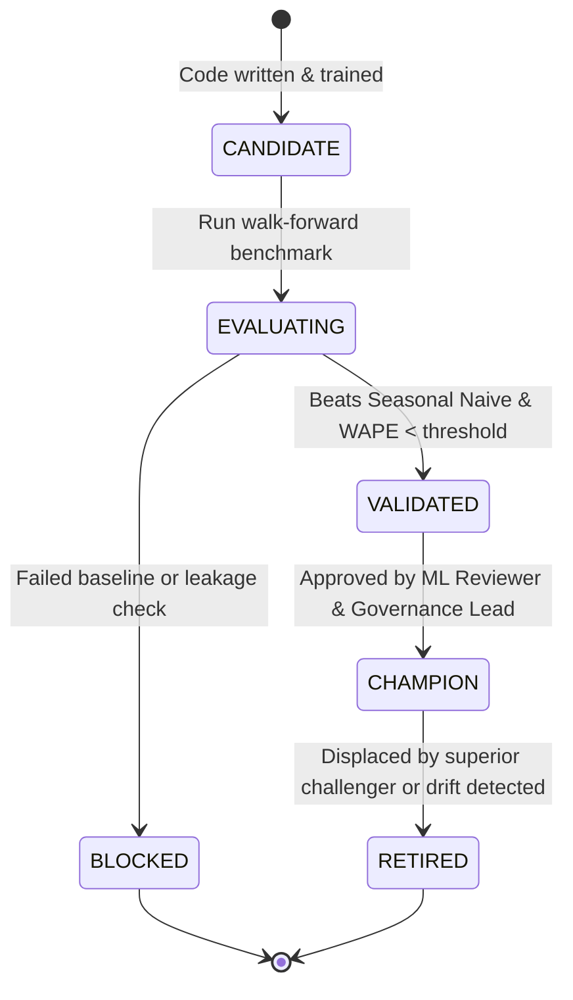

# LABREX Model Governance & Lifecycle Management

**Document Version:** 1.0  
**Authority:** Master Directive Section 48 & 77  
**Rule:** No model is promoted to CHAMPION without automated evaluation against baseline.  

---

## 1. Model Lifecycle States

---

## 2. Model Promotion Criteria

A model may attain `CHAMPION` status only if all criteria are satisfied:
1. **Benchmark Superiority**: $\text{WAPE}_{\text{candidate}} < 0.85 \times \text{WAPE}_{\text{seasonal\_naive}}$ on out-of-time walk-forward folds.
2. **Coverage Calibration**: 80% prediction intervals achieve an empirical coverage between 75% and 85%.
3. **No Temporal Leakage**: Code audit verifies lag features use only data strictly prior to cutoff timestamp $t$.
4. **Reproducible Artifact**: Training parameters, git commit hash, feature schema, and random seed are registered in `model_registry`.
5. **Model Card Documented**: Limitations, training data ranges, and intended use are formally published.

---

## 3. Drift Monitoring & Alerting

The platform runs automated weekly checks comparing incoming feature distributions with the baseline training set:
- **Population Stability Index (PSI)**: Evaluated for top features.
  - $\text{PSI} < 0.1$: No significant change.
  - $0.1 \le \text{PSI} < 0.25$: Moderate drift (warning logged).
  - $\text{PSI} \ge 0.25$: Severe drift (Model state flagged `NEEDS_RETRAINING`).
- **Residual Monitoring**: Tracks real vs forecast errors as new quarters arrive.
